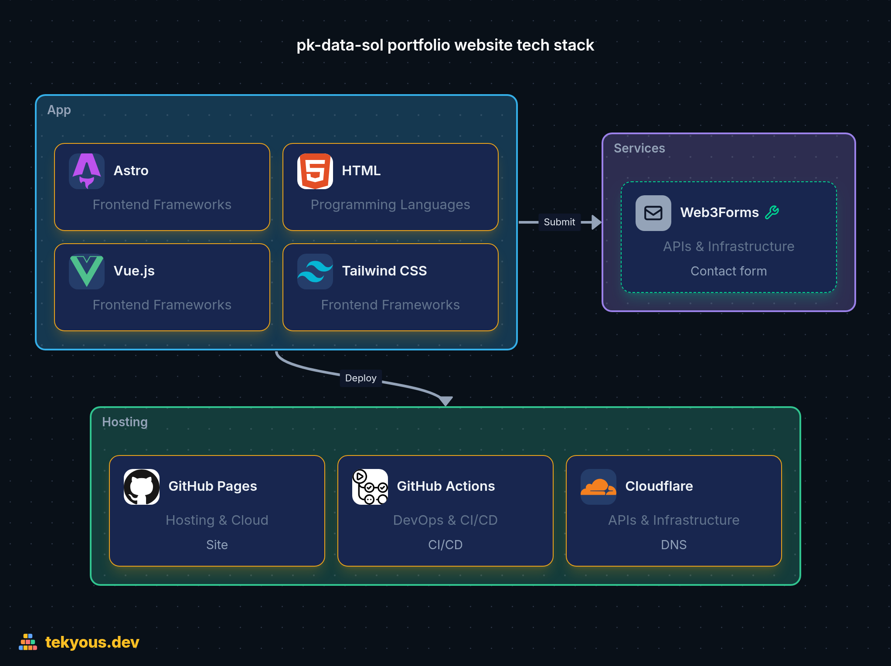

# Portfolio Website

Personal portfolio website built with Astro, Vue, and Tailwind CSS.

**Live:** [przemek-kepka.com](https://przemek-kepka.com)

## Tech Stack

[](https://tekyous.dev/builder?utm_source=mcp&utm_medium=readme#doc=v1.tZVRb9owEMe_CvJeoYM0UJK3qtXUvUyTeNjDNE1OcgEPxxfZDpQhvvvOTkIIhXWrVJ7ii333-5-Pf_YsR11wy2JmYb3DyoxSrjbcsCHbgDYCFYuDIcuEKSXfsXjPsLJSKKATKdcZ7ZO4RBZbXcGQKV5A-5xyC0vUO7-zeRyyUotUqCWLcy4N7aKslJH2JGBEBuzQhfbEVFBZ64olkqu1e4vJL0itYfH3PVsLlXn0Z0uphX8WVgItfCxm5XqUcctHBuWgRG1zlAIHW0iMsDCwkK4GxvJ0TSeM3UlXaQU8c4SkACVqinzI_Y8iXIqlcoJAWdBODlIi36U9e2ZxOB4yEhzMCdSI3-DCWxZHYXA4DI-8uXZtaoB5WTpcjx2ze79qC5u1a1kupHQLzJ3KBHUG_iVJydqj9w2YBL_Jx75KnrqcQvnOXoONZn3Y6TQcshWJiMKr0Ab0RqRgTsgXXajF3wiUYN9RwSyqJUzC8c24ryKIglrFeHZVxQqNrW-6FfF0jLQaoADNZfaOIibj25taRjgN-yLmk9klERZRHsfHWI1uemW1PFmeNyqo-zQNzroUzn2ByXhyrcDKFrLL36zO0t8G4Zvzbyro0teLy_DB7O6_k1su5JbCqTFdkX7wipR_rZZWxmLx87Qoucuts1WXvTZE9o1Cn5qQSOtidlf6sXBLclsuK7csCM7Z3Il78lKYkVA0unS5VWorfaFJd5PmiqPZi79CS17bUm1ze6pQ1ufZAyryQDtw0OxaK5fCrqpkVPIlnPTyLHo-2sG0Ge3p5H-hFmTQr8EQNG1-idPFz293fvdmoIfPHx8erxKlEqssl1yfTHMvdj7UYfRmkscvix4HTZCibyLqI8yIviqjdgZzjUX3ocG-fUuegLO1RZUUwnkW1xq3zvhU1px94irz7qj9-ePSad-KzK7c2EImKhqeV6E6z32J1b1rqR6hlLj7O1XSp7IXqH4c_gA)

- **[Astro](https://astro.build)** - Static site generator
- **[Vue.js](https://vuejs.org)** - Interactive components
- **[Tailwind CSS v4](https://tailwindcss.com)** - Utility-first styling
- **Content Collections** - Markdown-based content management

## Project Structure

```
pk-data-sol/
├── public/                 # Static assets (images, favicon, CNAME)
├── src/
│   ├── components/         # Astro + Vue components
│   ├── content/            # Markdown content (projects, blog)
│   │   ├── blog/           # Blog posts (.md)
│   │   ├── projects/       # Project case studies (.md)
│   │   └── config.ts       # Content collection schemas
│   ├── i18n/               # Translation files
│   │   ├── en.json         # English
│   │   └── pl.json         # Polish
│   ├── layouts/            # Page templates
│   ├── pages/              # Routes (file-based routing)
│   ├── styles/             # Global CSS
│   └── utils/              # Helper functions
├── docs/                   # Documentation
├── scripts/                # Utility scripts, like image processing, used outside the app
├── astro.config.mjs        # Astro configuration
└── package.json
```

## Development

```bash
npm install       # Install dependencies
npm run dev       # Start dev server (localhost:4321)
npm run build     # Build for production (outputs to dist/)
npm run preview   # Preview production build locally
```

## Key Features

### Content Collections

Projects and blog posts are managed via Markdown files with frontmatter:

```markdown
---
title: "Project Name"
description: "Short description"
descriptionPl: "Polish description for i18n"
category: "Web Application"
technologies: ["Python", "Flask"]
featured: true
projectType: "current"  # "fte" | "current" | "side"
---

Content here...
```

### Internationalization (i18n)

The site supports English and Polish with URL-based routing:

| Language | URL Pattern |
|----------|-------------|
| English  | `/`, `/projects`, `/blog` |
| Polish   | `/pl`, `/pl/projects`, `/pl/blog` |

UI translations are stored in `src/i18n/*.json`. Content uses `descriptionPl` fields for Polish card descriptions.

### Astro + Vue Components

- **Astro components** (`.astro`) - Static, zero JavaScript
- **Vue components** (`.vue`) - Interactive elements (language switcher, filters)

Vue components require `client:load` directive:
```astro
<LanguageSwitcher client:load lang={lang} />
```

### Contact Form

The contact form is handled by [Web3Forms](https://web3forms.com/) - a free, no-backend form submission service.

## Deployment

Deploys automatically to GitHub Pages via GitHub Actions on push to master. Custom domain is managed through Cloudflare DNS.

Configuration:
- `.github/workflows/deploy.yml` - CI/CD workflow
- `public/CNAME` - Custom domain
- `astro.config.mjs` - Site URL setting
- **Cloudflare** - DNS management, linking custom domain to GitHub Pages

## Documentation

- [`docs/PROJECT_STRUCTURE.md`](docs/PROJECT_STRUCTURE.md) - Full architecture guide
- [`docs/INTERNATIONALIZATION-i18n.md`](docs/INTERNATIONALIZATION-i18n.md) - i18n implementation details
- [`docs/PROJECT_DESCRIPTION_TEMPLATES.md`](docs/PROJECT_DESCRIPTION_TEMPLATES.md) - Content writing guidelines
